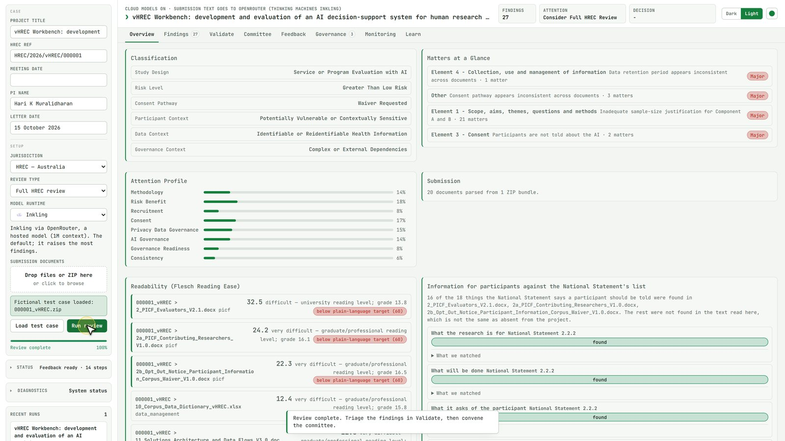
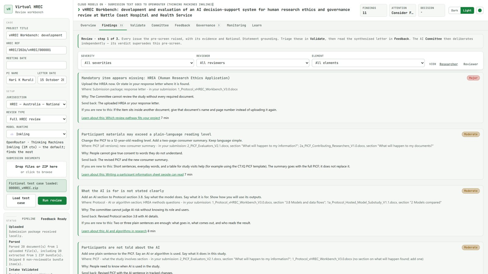
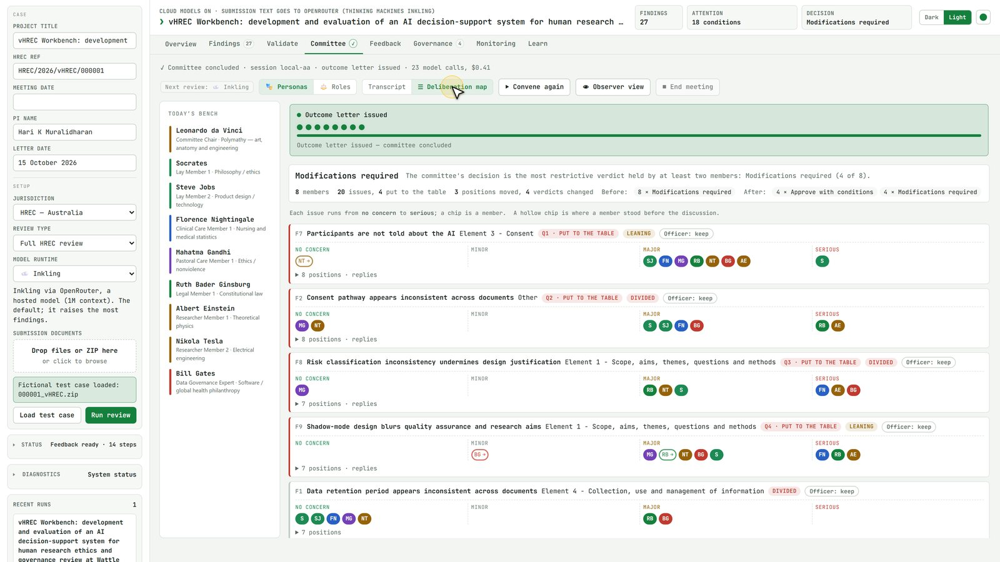
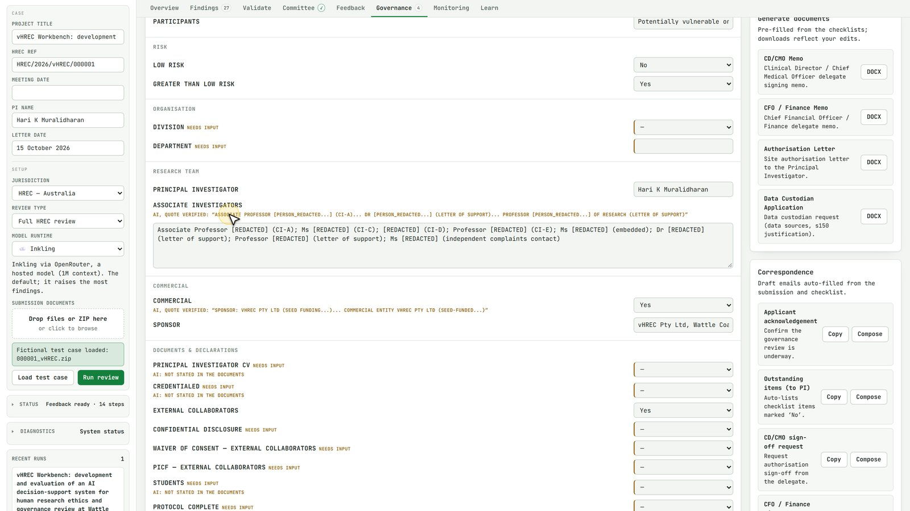
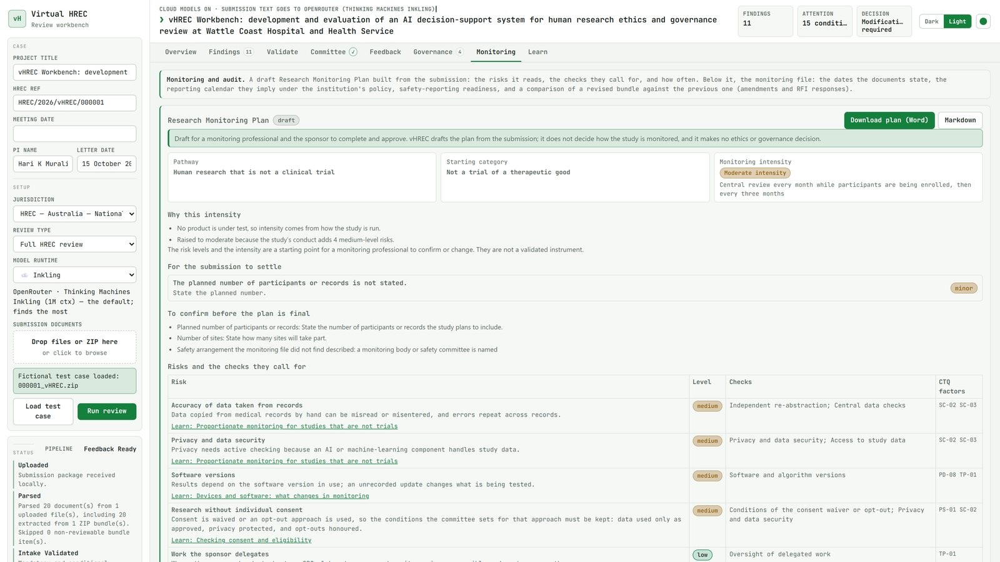
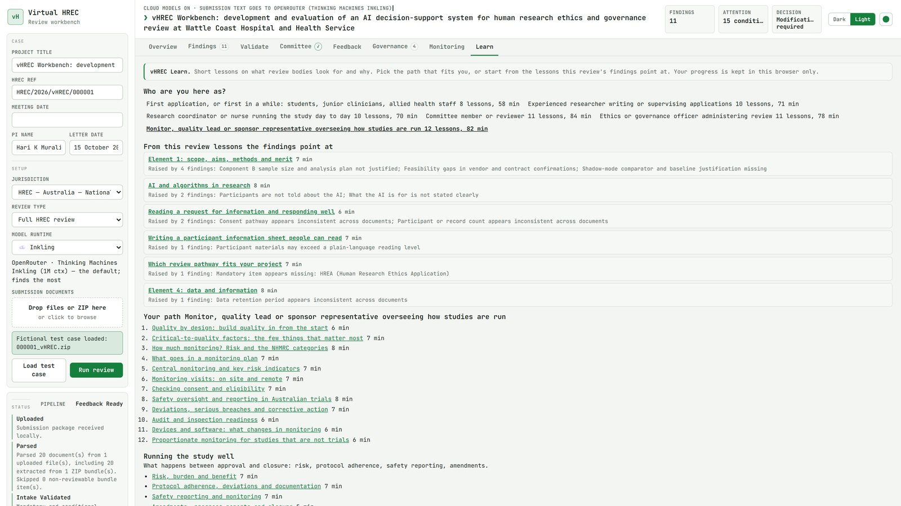
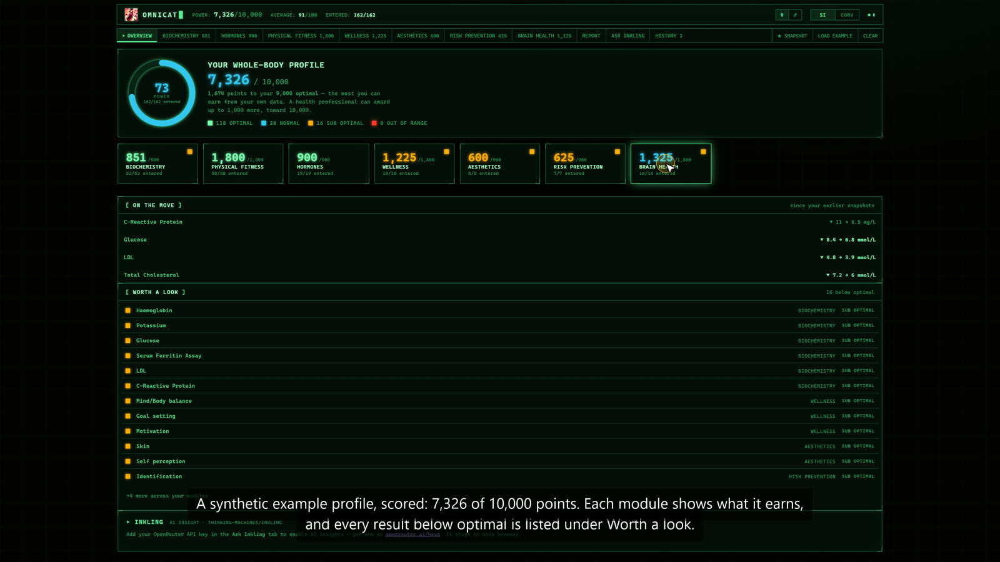
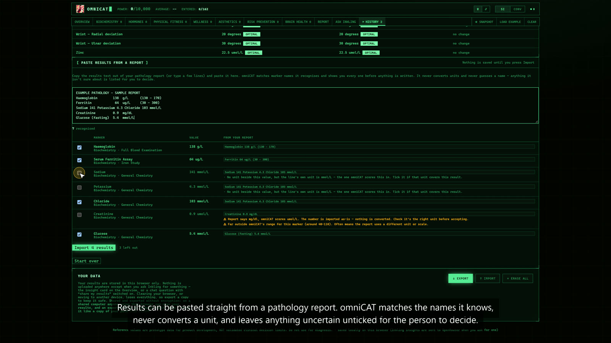

# vHREC

**AI decision support for human research ethics review, research governance and study monitoring.** People decide; vHREC drafts.

> **Status.** A working product, tested end to end on synthetic research projects. It has not yet been validated on genuine submissions, and we have no customers or revenue yet. We are looking for pilot partners: human research ethics committees, research governance offices and trial sponsors.

## Demo

One review of an invented study, from upload to the committee's draft decision, the governance paperwork, a draft monitoring plan and the learning paths. It runs on a hosted model, and the committee's members are public figures used as review lenses.

- [Watch the 2½-minute demo](https://github.com/haribo-hm/vHREC/releases/download/demo-2026-10-15/vHREC_demo_short_1080p.mp4) (MP4, 1080p, 47 MB)
- [The full 5½-minute tour](https://github.com/haribo-hm/vHREC/releases/download/demo-2026-10-15/vHREC_demo_full_1080p.mp4) (MP4, 1080p, 61 MB)
- [The 2½-minute demo for phones](https://github.com/haribo-hm/vHREC/releases/download/demo-2026-10-15/vHREC_demo_short_720p.mp4) (MP4, 720p, 11 MB)
- [The draft monitoring plan in 25 seconds](https://github.com/haribo-hm/vHREC/releases/download/demo-2026-10-15/vHREC_monitoring_clip_1080p.mp4) (MP4, 8 MB)

All four are on the [release page](https://github.com/haribo-hm/vHREC/releases/tag/demo-2026-10-15).

## What it does

One upload of a research submission package (protocol, participant information and consent forms, ethics application, data management plan and the rest) becomes six things.

1. **A pre-screen against Australia's National Statement on Ethical Conduct in Human Research (2025).** Each finding names where in the submission it arises, quotes the researcher's text where it can, and cites the passage of the National Statement it rests on. It is written for the researcher: what to change, where, why, and what to send back.
2. **A human checkpoint.** The ethics officer keeps, discusses or excludes each finding. Nothing reaches a researcher until a person has decided.
3. **A simulated committee sitting.** A multi-seat AI panel, with a seat for each membership category the National Statement requires, reviews the project. It debates the contested points under a chair, votes, and drafts the outcome letter. A deliberation map shows who changed position and why.
4. **Governance paperwork.** The site-specific assessment checklists are filled only where a verbatim quote from the submission supports the entry. The memos, authorisation letter and data custodian request are generated from them as Word documents.
5. **A draft research monitoring plan.** The plan gives the study's NHMRC (2018) risk category, the monitoring intensity that category starts from, the risks that raise it, and the checks each risk calls for. Each risk is tied to the Clinical Trials Transformation Initiative's critical-to-quality factors. The plan downloads as Word for a monitoring professional and the sponsor to complete.
6. **Learning at the point of need.** Short lessons on what review bodies look for are offered beside the findings that raise them. There are paths for first-time applicants, researchers, coordinators, committee members, ethics officers and monitors.

| Findings, as the researcher reads them | The committee's deliberation map |
|---|---|
|  |  |
| **Governance: a field filled from a verified quote** | **A draft research monitoring plan** |
|  |  |

## How it is built

- **Rules first.** A deterministic engine raises findings with their evidence. Models add judgement where rules cannot, and a model's quote is checked against the source text before it is shown.
- **Hosted or on-premises.** It runs on a hosted model (the demo uses Thinking Machines' Inkling through OpenRouter) or on open-weight models on the institution's own hardware. A real-submission lock refuses hosted model endpoints.
- **Drafts, not decisions.** Every output is a draft for the human committee or office. vHREC makes no ethics or governance decision.
- **Tested.** About 3,000 automated tests.

## Who it is for

- Human research ethics committees, and the research governance offices behind them.
- Trial sponsors and contract research organisations preparing submissions and monitoring studies.
- Institutions that want the workbench under their own name, with models tuned on their own records and run on their own infrastructure.

## The company

**Where clinical rigour meets digital health innovation.**

CDTR X vHREC is a contract research organisation in Queensland, Australia, focused on digital therapeutics. We help biotechnology startups, research institutions and principal investigators run compliant, audit-ready clinical trials, from first-in-human studies to AI-driven digital therapeutics. We use custom AI products, vHREC and omniCAT among them, to support ethics and governance review and clinical trial delivery.

| 10+ years | $1M+ | Multi-credentialed |
|---|---|---|
| Clinical trial oversight, from study start-up to close-out | Secured in funding for research infrastructure and units | CRA, Nurse Researcher and BridgeTech Fellow, working across Australia |

## Services

### Clinical trial project management

We offer full-scope project management, guiding trials from study start-up to close-out. Whether you are conducting early-phase investigator-initiated trials, theranostics studies or complex medical device registries, we manage the operational roadmap.

- **Study execution:** management of regulatory submissions, site qualification, site initiation visits (SIVs), and vendor and CRO oversight.
- **Operational excellence:** expert implementation of Quality-by-Design (QbD) principles, to ensure timelines are met without compromising scientific rigour.
- **Collaborative leadership:** acting as the primary liaison between principal investigators, biotechnology sponsors and clinical sites across Australia.

### Clinical trial consulting

We help organisations build research infrastructure from the ground up. Drawing on experience securing $1M+ in funding and scaling research units, we provide bespoke consulting to transform your research capabilities.

- **Infrastructure and scaling:** pitching business cases for research units, team recruitment, and establishing centralised operational models.
- **Governance frameworks:** authoring institutional research conduct policies, standard operating procedures (SOPs) and essential document templates that meet NHMRC and National Clinical Trials Governance Framework standards.
- **Mentorship and training:** certification and training of research staff in ICH-GCP principles and regulatory requirements, to foster a culture of quality.

### Research monitoring and compliance

Data integrity is the foundation of credible research. We provide expert, risk-based monitoring strategies that ensure audit readiness and alignment with ICH-GCP guidelines and ISO 14155:2026.

- **Full-scope monitoring:** interim monitoring visits (IMVs), source data review (SDR) and comprehensive reporting.
- **Risk mitigation:** authoring risk-based monitoring plans and quality management plans focused on critical-to-quality factors.
- **Inspection readiness:** preparation for TGA GCP inspections and sponsor audits, so your site or organisation remains in a constant state of compliance.
- **Safety oversight:** robust adverse event management systems and Data Safety Monitoring Boards (DSMBs) tailored to digital and investigational interventions.

### Digital health safety and quality

The rapidly evolving field of digital therapeutics and AI-driven clinical research requires specialised oversight. We provide the clinical governance frameworks needed to validate digital health interventions.

- **AI and machine learning strategy:** implementing machine learning algorithms in clinical settings, including validation of diagnostic performance (for example, automated radiography interpretation).
- **Digital governance:** navigating the regulatory pathways for Software as a Medical Device (SaMD) and ensuring compliant data collection.
- **Safety, quality and incident management:** monitoring of clinical incidents and adverse events.

### AI-enabled software

The vHREC workbench described above, available under your institution's name, and omniCAT, our clinical data capture tool, described below.

## omniCAT, our clinical data capture tool

omniCAT captures a person's health results and scores every result against an optimal target, in one profile out of 10,000 points across seven modules: biochemistry, hormones, physical fitness, wellness, aesthetics, risk prevention and brain health.

- **Capture from a report.** Results can be pasted straight from a pathology report. omniCAT matches the marker names it knows, shows every match before anything is written, never converts a unit, and leaves anything uncertain unticked for a person to decide.
- **Scored against optimal.** Each marker shows its optimal target, the near-optimal band, the wider laboratory range and the sources behind them. A health professional can award up to 1,000 further points.
- **History and reports.** Snapshots show each marker's trend over time, and the report sets out the whole profile, ready to print or save as PDF.
- **Ask Inkling.** Any result can be taken to Inkling as a pre-filled question. Nothing is sent until the person presses Send, and it runs on their own OpenRouter key.
- **The data stays with the person.** Results are stored in the browser only, export to a file and import back, and can be erased in one step.

omniCAT is a prototype: its reference values are prototype product data, not validated clinical decision limits, and it is not for diagnosis.

| A synthetic example profile | Results pasted from a pathology report |
|---|---|
|  |  |

- [Watch the 2½-minute omniCAT demo](https://github.com/haribo-hm/vHREC/releases/download/omnicat-demo-2026-10-15/omniCAT_demo_short_1080p.mp4) (MP4, 1080p, 9 MB)
- [The full 5-minute tour](https://github.com/haribo-hm/vHREC/releases/download/omnicat-demo-2026-10-15/omniCAT_demo_full_1080p.mp4) (MP4, 1080p, 14 MB)

The demo uses a synthetic profile and a synthetic pathology report; no real person's results appear.

## Team

- **Hari K Muralidharan**, co-founder.
- **Maame Amma Owusu**, co-founder.

Together the team brings research ethics and governance, clinical trial management, auditing and monitoring, and the vHREC and omniCAT software, built in-house.

## Contact

Hari K Muralidharan: [help@hari.com.au](mailto:help@hari.com.au)

---

This repository is the project page only. The vHREC software is not published here. The screenshots show an invented study at an invented institution, the fictional Wattle Coast Hospital and Health Service. The omniCAT screenshots show a synthetic profile. On the committee map, public figures stand in as review lenses for the committee's seats.

© 2026. All rights reserved; see [LICENSE](LICENSE).
